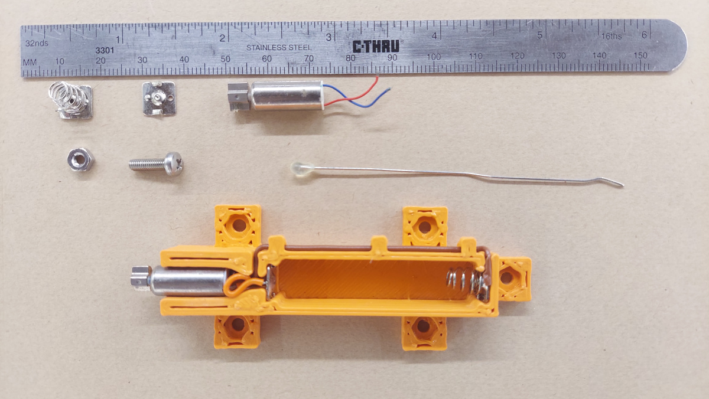
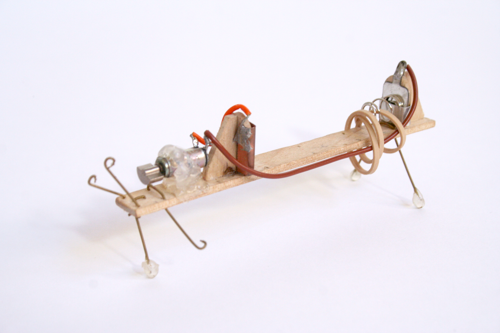
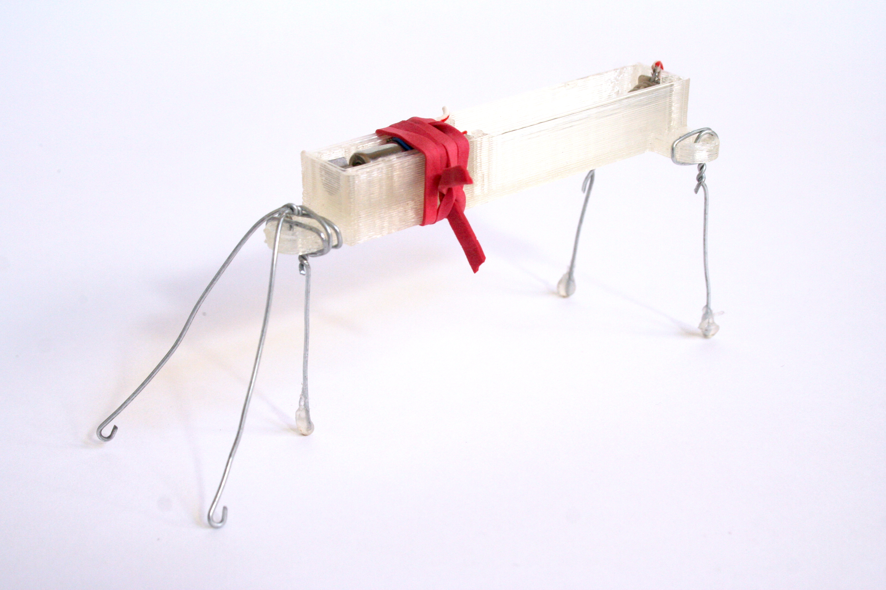
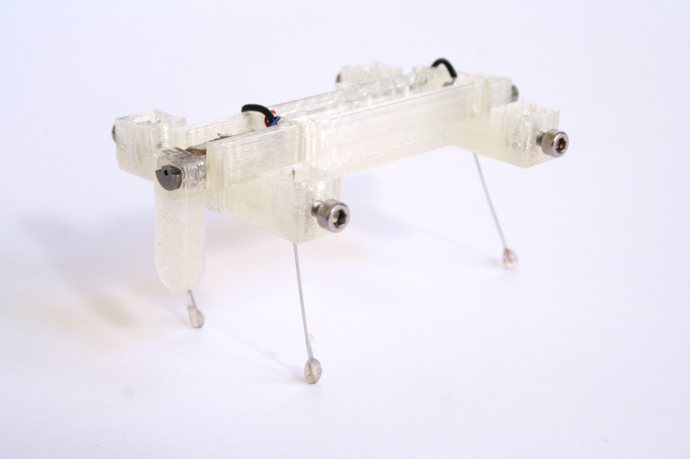
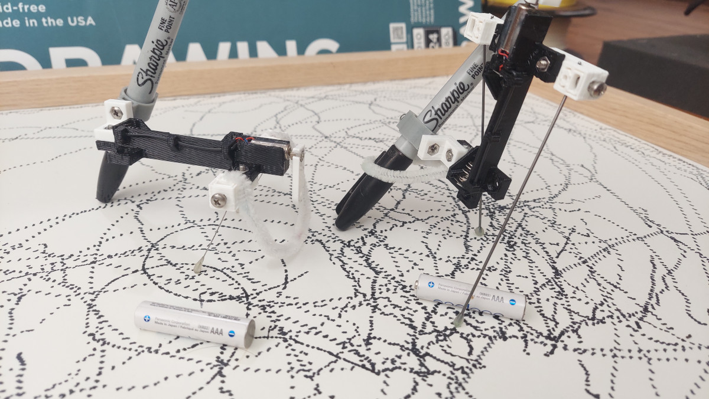

# BuzzBots: A Modular Toolkit for Mechanical Creatures

**BuzzBots** is an open-source system for building simple, vibration-actuated robots. By combining 3D-printed parts with standard M3 hardware and a single vibration motor, you can create anything from a physics-testing "bristlebot" to an autonomous drawing machine.

See this [YouTube video where I explain how to build a BuzzBot](https://www.youtube.com/watch?v=E980ggQ9a-k)

## What You’ll Need

I’ve designed these to be built with common "ingredients" to maximize the chance that they can propagate and grow in the wild:

- 3D printed parts (Found in the `/print ready parts` folder)
- Metric 3mm (M3) bolts and nuts
- Stiff steel wire ("music wire") tipped with hot glue
- 8mm AAA battery terminals
- A single AAA battery
- Small vibration motor (7mm diameter x 15mm long featured)

## Get Started

- Clone this repo or grab the STLs from the `print ready parts` folder.
- Print (PLA works great).
- Make legs out of stiff wire and put a drop of hot glue on the end to make a foot.
- Use the modular holes to bolt together your own morphology.

## History

I developed this toolkit back around 2012-2014. You can read about it on my website:

https://www.andrewfrueh.com/buzzbots/ 

Here's an early prototype made with a popsicle stick.

Then you can see it progress...

and progress...

... to the final form.

